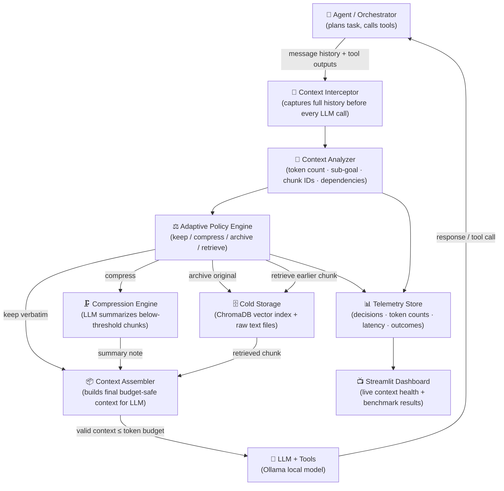

# Context Rot Firewall — Implementation Plan

## 1. The Problem

As an AI agent works through a long task its context window fills with tool outputs, file contents,
old decisions, and stale intermediate results. This is **not** context overflow (hitting the token
limit) — it happens well before the limit, because attention weights are softmax-normalised across
the entire context. As the context grows, each token — including early, critical instructions —
gets a proportionally smaller share of attention. Practitioners report visible coherence loss after
roughly 20–30 turns.

**Existing tools don't solve this:**

| Tool | What it does | Gap |
|---|---|---|
| Letta / MemGPT | OS-style tiered memory | Full framework lock-in; agent decides what to page |
| Mem0 / Hindsight | Cross-session personalization recall | Not turn-by-turn within-session triage |
| `/compact` commands | Summarize everything at token ceiling | Reactive + indiscriminate |

**The gap**: no lightweight, pluggable, *within-session, turn-by-turn* relevance triage layer exists.

---

## 2. Proposed Solution

A **model-agnostic Python middleware library** — the *Context Rot Firewall* — that intercepts the
context an agent is about to send to the LLM on every turn, and actively decides what stays, what
gets compressed, and what moves to retrievable cold storage.

**Guiding principle**: relevance to the *current sub-goal* — not recency and not raw token budget —
determines what the model actually sees.

**Core deliverable**: a `pip`-installable package + Streamlit dashboard + benchmark comparing
4 configurations (Baseline → Adaptive).

---

## 3. System Architecture



### Layer Breakdown

| # | Layer | File | Responsibility |
|---|---|---|---|
| 1 | Agent Loop | `agent/runner.py` | Plans task, calls tools, loops |
| 2 | Tools | `agent/tools.py` | File R/W, shell exec, search |
| 3 | Interceptor | `firewall/interceptor.py` | Wraps every `call_llm()` call |
| 4 | Chunker | `firewall/chunker.py` | Assigns stable IDs to (message, tool_result) pairs |
| 5 | Analyzer | `firewall/analyzer.py` | Token counts, sub-goal extraction, dependency detection, protected-item tagging |
| 6 | Relevance | `firewall/relevance.py` | Two-tier scorer: cheap embedding pass → expensive LLM pass for borderline |
| 7 | Policy | `firewall/adaptive_policy.py` | Rule-based keep/compress/archive/retrieve + budget awareness |
| 8 | Compressor | `firewall/compressor.py` | LLM-generates short summary of archived chunk |
| 9 | Storage | `firewall/storage.py` | ChromaDB + raw .txt archive |
| 10 | Retrieval | `firewall/retrieval.py` | Embed sub-goal → query Chroma → inject top-k back |
| 11 | Assembler | `firewall/assembler.py` | Builds ordered, role-valid context ≤ token budget |
| 12 | Dashboard | `dashboard/app.py` | Streamlit: token bar, relevance chart, eviction log, benchmark graph |

---

## 4. Adaptive Policy — Decision Logic

```
For each chunk in context history:

  IF chunk.is_protected:              → KEEP  (system prompts, constraints, deps)
  ELIF relevance_score ≥ HIGH_THRESH: → KEEP  (clearly relevant to sub-goal)
  ELIF relevance_score ≥ LOW_THRESH:  → COMPRESS (summarize + archive original)
  ELSE:                               → ARCHIVE (full text to Chroma; summary note stays)

  BUDGET OVERRIDE: if total_kept_tokens > budget × 0.8
    → Downgrade KEEP→COMPRESS for lowest-scoring kept chunks
```

**Relevance scoring (Two-Tier)**:
- **Tier 1 (all chunks)**: cosine similarity between chunk embedding and current sub-goal embedding via `all-MiniLM-L6-v2`. Fast, free, CPU-friendly.
- **Tier 2 (borderline only, score between LOW and HIGH)**: LLM-judged 0–10 relevance call. Expensive — only called for ambiguous chunks.

**Protected items** (never evicted):
- System instructions and role assignments
- Explicit user constraints / requirements
- Unresolved tool calls (tool_use without tool_result)
- Chunks with active dependency edges (referenced by a kept chunk)

---

## 5. Directory Structure

```
context-rot-firewall/
├── agent/
│   ├── __init__.py
│   ├── runner.py          # Main agent loop
│   └── tools.py           # Tool implementations
├── firewall/
│   ├── __init__.py
│   ├── interceptor.py     # LLM call wrapper + hook
│   ├── chunker.py         # Chunk creation + stable IDs
│   ├── analyzer.py        # Token counting + sub-goal + protection tagging
│   ├── relevance.py       # Two-tier scorer
│   ├── adaptive_policy.py # Policy engine
│   ├── compressor.py      # Chunk summarizer
│   ├── storage.py         # ChromaDB + file archive
│   ├── retrieval.py       # Retrieve from cold storage
│   └── assembler.py       # Final context builder
├── evaluation/
│   ├── __init__.py
│   ├── tasks.py           # Task definitions
│   ├── benchmark.py       # Runs A/B/C/D comparison
│   └── metrics.py         # Metric collectors
├── dashboard/
│   └── app.py             # Streamlit dashboard
├── tests/
│   ├── test_chunker.py
│   ├── test_relevance.py
│   ├── test_policy.py
│   ├── test_assembler.py
│   └── test_integration.py
├── archive/               # Flat-file chunk originals (auto-created)
├── chroma_db/             # ChromaDB persistence (auto-created)
├── logs/                  # JSON telemetry logs (auto-created)
├── config.yaml
├── requirements.txt
└── README.md
```

---

## 6. Tech Stack

| Layer | Tool | Why |
|---|---|---|
| Language | Python 3.11+ | Ecosystem fit |
| Local LLM | Ollama (`llama3.2:3b` or `qwen2.5:7b`) | Free, local, no API charges |
| Embeddings | `sentence-transformers` (`all-MiniLM-L6-v2`) | Free, CPU-friendly, 384-dim |
| Vector DB | `chromadb` (local) | Free, simple Python API |
| Token counting | `tiktoken` | Accurate, fast |
| Dashboard | `streamlit` | Rapid UI, already in stack |
| Testing | `pytest` | Standard |
| Config | `PyYAML` | Human-readable thresholds |

---

## 7. Phased Build Plan

### Phase 0 — Scaffold (NOW, ~30 min)
- Create full directory structure
- `requirements.txt`, `config.yaml`, base `__init__.py` files
- Confirm Ollama is reachable

### Phase 1 — Baseline Agent (Day 1)
- `agent/tools.py`: `read_file`, `write_file`, `run_shell`, `list_dir` tools
- `agent/runner.py`: tool-calling loop using Ollama `/api/chat` with tools
- Log every request + response to `logs/baseline_<timestamp>.json`
- **Milestone**: Agent completes a small coding task end-to-end. Context grows unchecked. Logs saved.

### Phase 2 — Core Firewall (Day 2–3)
- `firewall/interceptor.py`: intercept + hook into runner
- `firewall/chunker.py`: chunk messages into stable-ID units
- `firewall/analyzer.py`: token counts + sub-goal extraction + protection tags
- `firewall/relevance.py`: Tier-1 embedding scorer
- **Milestone**: Every turn produces a scored chunk list visible in logs.

### Phase 3 — Policy Engine (Day 3–4)
- `firewall/adaptive_policy.py`: threshold rules + budget awareness
- `firewall/compressor.py`: LLM summary of below-threshold chunks
- `firewall/storage.py`: ChromaDB + flat-file archive
- **Milestone**: Firewall actively compresses/archives chunks; context stays within budget.

### Phase 4 — Recovery (Day 4–5)
- `firewall/retrieval.py`: embed sub-goal → query Chroma → return top-k
- `firewall/assembler.py`: full context builder with role/order/tool-ID preservation
- **Milestone**: Round-trip: archive chunk → later retrieve it → confirm it appears in model input.

### Phase 5 — Evaluation (Day 6–7)
- `evaluation/tasks.py`: 3 test scenarios (forgotten requirement, recover discovery, multi-file coding)
- `evaluation/benchmark.py`: runs all 4 configs (A/B/C/D) on same task set
- `evaluation/metrics.py`: collects success rate, token use, latency, retrieval accuracy
- **Milestone**: First comparison graph: task success rate vs. session length, with/without firewall.

### Phase 6 — Dashboard (Day 7–8)
- `dashboard/app.py`: Streamlit UI with live token bar, relevance histogram, eviction log, benchmark graph
- **Milestone**: Live dashboard observable during an agent run.

---

## 8. Testing Strategy

### Unit Tests (`tests/`)

| Test file | What it covers |
|---|---|
| `test_chunker.py` | Correct chunk IDs, role preservation, tool-call pairing |
| `test_relevance.py` | Tier-1 scores are in [0,1]; high-relevance chunks score > 0.5 on known examples |
| `test_policy.py` | Protected chunks never get archived; budget override triggers when expected |
| `test_assembler.py` | Output context never exceeds token budget; roles are valid; tool-call IDs preserved |
| `test_integration.py` | End-to-end: archive chunk → query → retrieve → appears in assembled context |

Run with: `pytest tests/ -v`

### Benchmark Evaluation (`evaluation/`)

**4 configurations on the same task set:**

| Config | Strategy |
|---|---|
| A — Baseline | Raw agent, no context management |
| B — Simple compaction | Truncate oldest chunks when > 75% budget |
| C — Fixed relevance | Embedding scores with fixed thresholds, no budget awareness |
| D — Adaptive firewall | Full system: task-aware + budget-aware + retrieval |

**3 Test Scenarios:**

1. **Forgotten Requirement** — Insert constraint early. Add 20 unrelated tool calls. Did agent still follow the constraint?
2. **Recover Earlier Discovery** — Early tool call finds key info. 30+ intervening turns. Does agent use it again at turn 50?
3. **Multi-file Coding Task** — Edit 5 files, run tests, fix failures across 40+ turns. Measure correct edits / test pass rate.

**Metrics collected per run:**

| Metric | How measured |
|---|---|
| Task success rate | Pass/fail per scenario (deterministic where possible) |
| Critical-info retention | Did protected chunks survive? |
| Input tokens consumed | `tiktoken` count per turn, summed |
| Compression ratio | Compressed tokens / original tokens |
| End-to-end latency | Wall-clock per turn |
| Retrieval accuracy | Retrieved chunk relevant to query? (embedding cosine ≥ 0.7) |

### Manual Smoke Tests (During Development)

- Run agent on "write a Python script that reads a CSV and prints statistics" task
- Watch dashboard update live during the run
- Inspect `logs/` JSON after each run
- Confirm archived chunks are readable in `archive/` directory

---

## 9. Configuration (config.yaml)

```yaml
token_budget: 4096          # Max tokens to send to LLM per turn
high_relevance_threshold: 0.75  # Score above this → KEEP
low_relevance_threshold: 0.40   # Score below this → ARCHIVE; between → COMPRESS
budget_pressure_ratio: 0.80     # Downgrade to COMPRESS when used tokens > budget × this
embedding_model: "all-MiniLM-L6-v2"
ollama_model: "llama3.2:3b"
ollama_url: "http://localhost:11434"
chroma_persist_dir: "./chroma_db"
archive_dir: "./archive"
log_dir: "./logs"
llm_judge_enabled: true         # Enable Tier-2 LLM scoring
protected_roles: ["system"]     # Roles that are always kept
```

---

## 10. Deliverables Checklist

- [ ] `pip`-installable `context-rot-firewall` package with documented API
- [ ] Baseline agent + firewall-wrapped agent both runnable
- [ ] Context Health Dashboard (Streamlit)
- [ ] Benchmark suite: 4 configs × 3 scenarios × 5 metrics
- [ ] Written project report
- [ ] Live demo script (baseline degrading vs firewall staying on-task)
